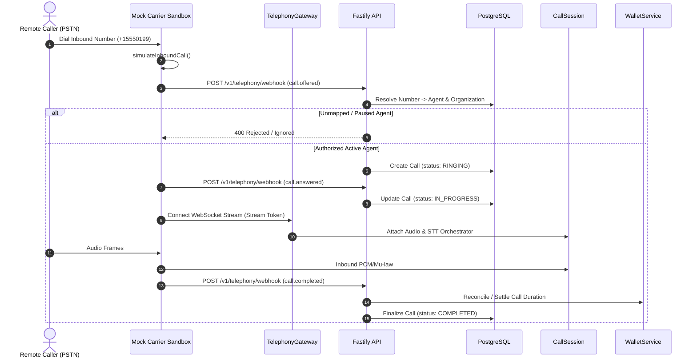
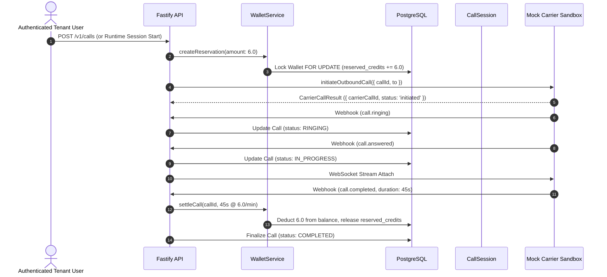

# Auris Phase 4.2 — Provider-Neutral Carrier Adapter Architecture

## 1. Executive Overview

Auris is a multi-tenant Voice AI workforce platform designed to power intelligent real-time conversational agents. In Phase 4, Auris introduced an initial provider-neutral telephony gateway, WebSocket media streaming, HMAC-SHA256 webhook authentication, short-lived stream tokens, and atomic crash recovery.

**Phase 4.2** establishes a strict, carrier-independent abstraction layer: the **Provider-Neutral Carrier Adapter Framework**, accompanied by a deterministic **Mock Telephony Sandbox**, standardized **Audio Codec Boundaries** (including ITU-T G.711 μ-law with reference vectors and linear interpolation resampling), distributed replay protection contracts, and automated financial safety nets.

This architecture enforces complete isolation between carrier-specific signaling/media protocols (e.g., Twilio, Plivo, Telnyx, or SIP) and the internal Auris Voice Runtime state machine.

---

## 2. Core Architecture Principles

1. **Provider Neutrality:** All carrier-specific payload parsing, signaling protocols, and transport quirks are strictly confined within implementations of `ICarrierAdapter`. The internal Auris runtime operates solely on normalized events and standardized audio buffers.
2. **Single Canonical Lifecycle:** Regardless of carrier event naming (`connected`, `answered`, `completed`, `hangup`), all events map directly into legal Auris `CallStateMachine` transitions.
3. **Durable Authority:** The PostgreSQL database is the single authoritative source of call ownership, tenant mapping, and lifecycle state. Carrier-supplied IDs never supersede internal authorization.
4. **Tenant Isolation by Construction:** Provider events claiming internal call or organization IDs are cross-referenced against trusted server-side records. Mismatches fail closed with `CROSS_TENANT_CALL_MISMATCH`.
5. **Deterministic Mock Sandbox:** Local development and testing run completely within a deterministic simulation sandbox (`MockCarrierSandbox`), eliminating any need for live carrier connections, phone numbers, or external credentials.
6. **Explicit Codec Boundaries:** Audio formats are never guessed from raw bytes. Format metadata, frame byte alignments, channel counts, and sample representations are strictly validated at the transport boundary.

---

## 3. Carrier Adapter Interface (`ICarrierAdapter`)

Located in [`packages/runtime/src/telephony/ICarrierAdapter.ts`](file:///e:/Nothing/packages/runtime/src/telephony/ICarrierAdapter.ts), `ICarrierAdapter` defines the contract that every telephony carrier integration must fulfill:

```ts
export interface ICarrierAdapter {
  readonly id: string;
  readonly capabilities: CarrierCapabilities;

  initiateOutboundCall(request: OutboundCallRequest): Promise<CarrierCallResult>;
  terminateCall(request: TerminateCarrierCallRequest): Promise<void>;
  normalizeEvent(input: unknown): NormalizedCarrierEvent;
  getHealth(): Promise<CarrierHealthResult>;
  dispose(): Promise<void>;
}
```

### Carrier Capabilities
The adapter declares its capabilities explicitly at initialization via `CarrierCapabilities`:
- `supportsInbound: boolean`
- `supportsOutbound: boolean`
- `supportsBidiStreaming: boolean`
- `supportsBargeInFlush: boolean`
- `supportedEncodings: AudioEncoding[]` (e.g., `['pcm_16000', 'pcm_8000', 'mulaw_8000']`)
- `maxFrameDurationMs: number` (standard: 20ms)
- `maxFrameSizeBytes: number` (standard: 4096 bytes)

---

## 4. Normalized Internal Event Model

Carriers deliver wildly diverging webhook payloads. The normalizer maps untrusted inputs into `NormalizedCarrierEvent`:

```ts
export interface NormalizedCarrierEvent {
  eventId: string;
  providerEventId?: string;
  providerId: string;
  eventType: NormalizedCarrierEventType;
  carrierCallId: string;
  callId?: string;
  timestamp: number;
  payload: Record<string, unknown>;
  correlationId?: string;
  sequenceNumber?: number;
  payloadFingerprint?: string;
}
```

### Supported Lifecycle Events
The model maps to legal Auris state machine transitions:
- `call.offered`: Inbound PSTN/SIP call offered to Auris.
- `call.initiated`: Outbound carrier leg initiated.
- `call.ringing`: Remote destination or carrier leg is ringing.
- `call.answered`: Remote party answered; call is connected.
- `media.requested`: Carrier requests WebSocket streaming endpoint.
- `media.connected`: Media streaming WebSocket attached and authenticated.
- `media.disconnected`: Media transport closed or superseded.
- `call.completed`: Call terminated normally.
- `call.failed`: Call failed due to network, carrier, or provider error.
- `call.rejected`: Destination rejected or blocked the call.
- `call.busy`: Remote party line busy.
- `call.unanswered`: Destination rang until timeout without answering.
- `call.cancelled`: Call was cancelled by originator before answer.
- `transport.error`: Carrier signaling or transport failure.

---

## 5. Inbound & Outbound Call Lifecycles

### Inbound Call Lifecycle Flow


### Outbound Call Lifecycle Flow


---

## 6. Audio Codec Boundaries & G.711 μ-Law Standard

Located in [`packages/runtime/src/telephony/AudioCodec.ts`](file:///e:/Nothing/packages/runtime/src/telephony/AudioCodec.ts):

### Internal Media Format
- **Sample Rate:** 16,000 Hz
- **Channels:** 1 (Mono)
- **Bit Depth:** 16-bit signed linear PCM (`pcm_16000`, little-endian)
- **Frame Duration:** 20 ms
- **Frame Size:** 640 bytes (320 samples × 2 bytes)

### Carrier G.711 μ-Law Format
- **Sample Rate:** 8,000 Hz
- **Channels:** 1 (Mono)
- **Bit Depth:** 8-bit companded μ-law (`mulaw_8000`)
- **Frame Duration:** 20 ms
- **Frame Size:** 160 bytes (160 samples × 1 byte)

### ITU-T G.711 Companding & Resampling
1. **Linear PCM to μ-Law:**
   - Adds ITU-T bias $0x84$ (132).
   - Clips input to $[-32635, +32635]$.
   - Extracts 3-bit exponent and 4-bit mantissa.
   - Inverts all bits (`~ulaw & 0xff`).
2. **Downsampling (16 kHz $\rightarrow$ 8 kHz):**
   - 2:1 decimation with consecutive 2-sample averaging (`Math.round((s0 + s1) / 2)`) providing anti-aliasing filter characteristics.
3. **Upsampling (8 kHz $\rightarrow$ 16 kHz):**
   - 1:2 expansion with linear interpolation between adjacent samples ($s_i$ and $(s_i + s_{i+1}) / 2$).
4. **Reference Vectors & Determinism:**
   - Silence ($0$) $\leftrightarrow$ $0\text{xFF}$ ($255$) $\leftrightarrow$ $0$
   - Positive Saturation ($+32767$) $\rightarrow$ $0\text{x80}$ $\rightarrow$ $+32124$ (quantization loss: $1.9\%$)
   - Negative Saturation ($-32768$) $\rightarrow$ $0\text{x00}$ $\rightarrow$ $-32124$ (quantization loss: $1.9\%$)
   - Intermediate: $1000 \rightarrow 0\text{xCE} \rightarrow 988$, $5000 \rightarrow 0\text{xAB} \rightarrow 5116$.

---

## 7. Deterministic Fault-Injection Sandbox

Located in [`packages/runtime/src/telephony/MockCarrierSandbox.ts`](file:///e:/Nothing/packages/runtime/src/telephony/MockCarrierSandbox.ts), `MockCarrierSandbox` supports configurable deterministic scenarios:

```ts
export interface MockCarrierScenario {
  seed?: number;
  eventDelayMs?: number;
  duplicateEvents?: boolean;
  duplicateEventRate?: number;
  outOfOrderEvents?: boolean;
  droppedEventTypes?: NormalizedCarrierEventType[];
  forceInitiationFailure?: boolean;
  forceInitiationFailureReason?: string;
  forceAnswerTimeout?: boolean;
  temporaryUnavailability?: boolean;
  unavailabilityDurationMs?: number;
  codecType?: 'pcm_16000' | 'mulaw_8000';
  mediaConfig?: Partial<MediaQueueConfig>;
}
```

- Zero production risk: Sandbox code has no external network sockets, no real carrier APIs, and cannot be reached by unauthenticated public clients.
- Configurable failure simulation: Delays, drops, forced initiation errors, duplicate events, and answer timeouts run deterministically in automated tests.

---

## 8. Extension Points for Future Carrier Adapters

When authorized in a future phase, a real carrier adapter (e.g., `TwilioCarrierAdapter`, `PlivoCarrierAdapter`) will implement `ICarrierAdapter` and plug directly into `TelephonyGateway`:

1. Implement `initiateOutboundCall`: Invoke carrier REST API to dial out.
2. Implement `terminateCall`: Invoke carrier REST API to hang up call leg.
3. Implement `normalizeEvent`: Translate carrier webhook payloads into `NormalizedCarrierEvent`.
4. Provide `AudioCodec`: Select `G711MuLawCodec` for μ-law carriers or `PassThroughPCM16kCodec` for linear PCM carriers.
5. Register with `TelephonyGateway.registerProvider(adapter, verifier)`.
