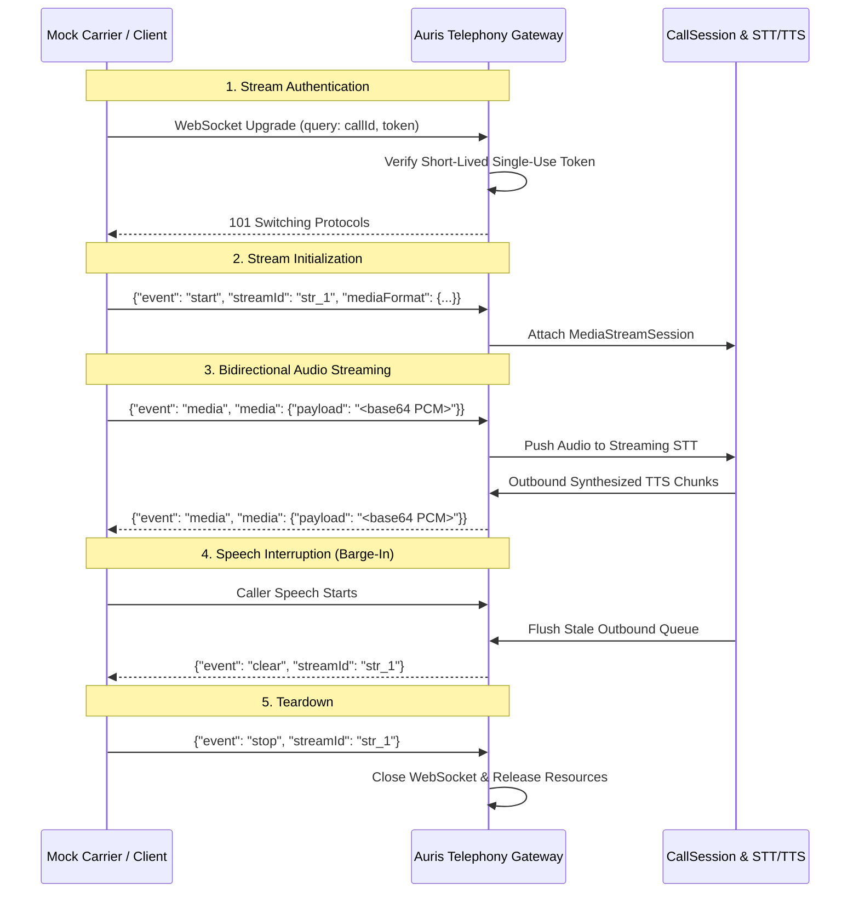

# Auris Mock Media Protocol Specification
**Protocol Identifier:** `auris-mock-media-v1`  
**Phase:** 4 — Provider-Neutral Telephony Gateway & Media Streaming  
**Status:** MOCK PROTOCOL ONLY — NOT AN OFFICIAL CARRIER PROTOCOL

> [!IMPORTANT]
> **MOCK PROTOCOL NOTICE**  
> The message schemas, framing rules, and parameters documented herein represent the **Auris Mock Media Protocol** developed exclusively for local deterministic emulation, testing, and interface isolation.  
> These messages are **not** official Twilio Media Streams, Plivo Audio Streams, or any other commercial carrier protocol. Live carrier adapters in future phases will map their respective native proprietary wire protocols to Auris internal audio frames through provider-specific adapters.

---

## 1. Protocol Architecture & Transports

The Auris Mock Media Protocol operates over standard WebSocket connections (`ws://` locally) between a simulated telephony carrier client and the Auris Telephony Gateway (`GET /v1/telephony/stream`).

### Session Lifecycle


---

## 2. Audio Format & Framing Policy

| Parameter | Specification | Notes |
| :--- | :--- | :--- |
| **Audio Format** | Raw Linear PCM (Signed 16-bit little-endian) | Format identifier: `audio/x-l16` or `pcm_16000` |
| **Sample Rate** | 16,000 Hz (16 kHz) | Optional fallback: 8,000 Hz (8 kHz) |
| **Channels** | 1 (Mono) | Multi-channel audio rejected with `UnsupportedAudioFormatError` |
| **Frame Duration** | 20 ms standard frame | 16,000 samples/sec × 2 bytes × 0.02s = **640 bytes raw** |
| **Payload Encoding** | Standard Base64 | Decoded payload validated against `maxFrameSize` |

---

## 3. Protocol Message Schemas

All messages exchanged over the WebSocket transport are JSON text frames encoded in UTF-8.

### 3.1 Start Message (`event: "start"`)
Emitted by the client immediately after connection to declare stream identifiers and negotiation parameters.

```json
{
  "event": "start",
  "streamId": "mock-stream-001",
  "callReference": "carrier-leg-987654",
  "mediaFormat": {
    "encoding": "audio/x-l16",
    "sampleRate": 16000,
    "channels": 1
  },
  "customParameters": {
    "callId": "7d9b5420-a65c-4d55-89ec-9e9d6d3761a2"
  }
}
```

- `event` (*string*, required): `"start"`
- `streamId` (*string*, required): Stable identifier for this media stream leg.
- `callReference` (*string*, required): Provider carrier call leg identifier.
- `mediaFormat` (*object*, optional): Codec parameters. Must match supported configurations (`audio/x-l16`, `16000` or `8000` Hz, `1` channel).
- `customParameters` (*object*, optional): Metadata attributes.

### 3.2 Media Message (`event: "media"`)
Bidirectional message carrying encoded audio frames.

```json
{
  "event": "media",
  "streamId": "mock-stream-001",
  "sequenceNumber": 42,
  "media": {
    "payload": "v8b//v///wAAAAD//w==",
    "timestamp": 1700000000120
  }
}
```

- `event` (*string*, required): `"media"`
- `streamId` (*string*, required): Stream identifier matching the active session.
- `sequenceNumber` (*integer*, optional): Monotonically increasing non-negative sequence counter.
- `media.payload` (*string*, required): Valid base64-encoded PCM bytes.
- `media.timestamp` (*number*, optional): Epoch or media offset in milliseconds.

### 3.3 Clear / Flush Message (`event: "clear"`)
Emitted by the gateway when a caller barges in or interrupts agent playback. Instructs the client/carrier to purge its local playback buffer immediately.

```json
{
  "event": "clear",
  "streamId": "mock-stream-001"
}
```

### 3.4 Stop Message (`event: "stop"`)
Indicates normal termination of the media stream.

```json
{
  "event": "stop",
  "streamId": "mock-stream-001",
  "reason": "NORMAL_HANGUP"
}
```

### 3.5 Error Message (`event: "error"`)
Indicates an unrecoverable protocol or processing error.

```json
{
  "event": "error",
  "streamId": "mock-stream-001",
  "error": {
    "code": "MALFORMED_FRAME",
    "message": "Incoming message size exceeds maximum limit"
  }
}
```

---

## 4. Message Bounds & Queue Constraints

| Limit Parameter | Default Value | Policy on Breach |
| :--- | :--- | :--- |
| `maxMessageSize` | 16,384 bytes (16 KB) | Rejects frame with `MalformedMediaFrameError` |
| `maxFrameSize` | 4,096 bytes (4 KB) | Rejects decoded frame with `MalformedMediaFrameError` |
| `maxQueuedFrames` | 50 frames | Throws `QueueOverflowError` and closes stream |
| `maxQueuedBytes` | 65,536 bytes (64 KB) | Throws `QueueOverflowError` and closes stream |
| `idleTimeoutMs` | 30,000 ms (30 s) | Cleanly closes stream with `IDLE_TIMEOUT` |

---

## 5. Security & Authentication Constraints

1. **Authentication:** The stream must be authenticated via a short-lived, single-use stream token issued by `POST /v1/telephony/stream-token`.
2. **Close Codes:**
   - `1000`: Normal closure (call hangup).
   - `1008`: Policy violation (missing, expired, reused, or invalid stream token; cross-tenant presentation).
   - `1011`: Internal gateway exception.
3. **Data Redaction:** Stream tokens, secrets, credentials, and raw audio payloads are strictly redacted from logs.
